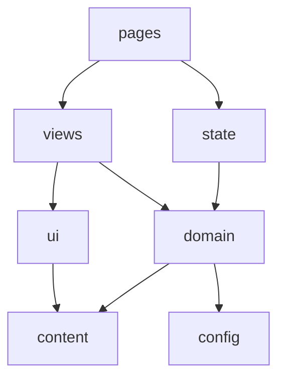
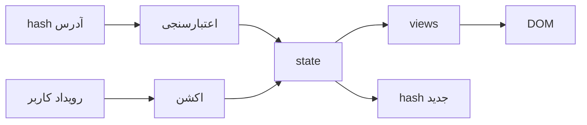

# معماری

این پروژه یک پروتوتایپ تعاملی و کاملاً ایستا برای تجربه‌ی دو کیف پول است. بک‌اند ندارد و همه‌ی داده‌هایش فرضی است.

## مسئله‌ی ساختار قبلی

| مسئله | اثر | راه‌حل |
|---|---|---|
| سه HTML تک‌فایل، هر کدام با کپی کامل CSS، داده و فونت | هر تغییر سه بار انجام می‌شد | ماژول‌ها و فایل‌های مشترک |
| منطق، HTML و state سراسری در هم | قواعد قابل تست نبود | لایه‌ی `domain` خالص |
| ورودی URL بدون اعتبارسنجی به `innerHTML` می‌رسید | XSS | schema برای state و CSP |
| لینک اشتراک همه‌ی state را نگه نمی‌داشت | بازبین حالت دیگری می‌دید | کدک URL با تست رفت‌وبرگشت |
| پوسته فقط برای دسکتاپ عریض بود | لینک در موبایل قابل استفاده نبود | پوسته‌ی واکنش‌گرا |

## ساختار

```text
site/                     تنها پوشه‌ای که منتشر می‌شود
├── index.html            پروتوتایپ
├── scenarios.html        ماتریس سناریوها
├── copy.html             متن‌ها
├── 404.html
├── assets/fonts/
├── styles/               توکن، پایه، پوسته، اپ، موبایل، سند
└── js/
    ├── config.js         ثابت‌ها و آستانه‌ها
    ├── content/          متن، سناریو، فرض و چک‌لیست
    ├── domain/           قواعد کیف پول، تراکنش و پرداخت
    ├── state/            schema، اکشن‌ها و کدک URL
    ├── ui/               قالب‌بندی، آیکون و اجزای مشترک
    ├── views/            توابع state → HTML
    └── pages/            اتصال به DOM
scripts/serve.mjs         سرور محلی با مسیر مشابه Pages
tests/
├── unit/                 قواعد، state و مرزهای معماری
└── e2e/                  مرورگر واقعی
```

## جهت وابستگی



- `domain` و `state` به DOM، `ui` و `views` دسترسی ندارند.
- `views` فقط HTML برمی‌گرداند و state را تغییر نمی‌دهد.
- فقط `pages` به DOM، آدرس و کلیپ‌بورد دست می‌زند.

هر لایه می‌تواند از لایه‌های پایین‌ترش هم مستقیم import کند. فهرست دقیق مجازها در `tests/unit/architecture.test.js` است و با تست کنترل می‌شود.

## جریان داده



## قرارداد URL

- `#s=C02` یک سناریوی دست‌نخورده است.
- `#st={...}` تفاوت state با پیش‌فرض است، به‌صورت encodeشده.
- کلید یا مقدار ناشناخته نادیده گرفته می‌شود و آدرس خراب به حالت پیش‌فرض می‌رسد.

## تصمیم‌ها

| تصمیم | گزینه‌ی ردشده | دلیل |
|---|---|---|
| ES Modules بدون build | Vite و React | سه صفحه‌ی ایستا به build و وابستگی runtime نیاز ندارد |
| مسیرهای نسبی | مسیر مطلق | Pages پروژه زیر `/<repo>/` سرو می‌شود |
| انتشار فقط `site/` با Actions | انتشار از شاخه | تست پیش‌نیاز انتشار است |
| هدایت با hash | History API | Pages قابلیت rewrite ندارد |
| داده‌ی کاملاً فرضی | داده‌ی واقعی | ریپو و سایت عمومی‌اند |

## محدودیت‌ها

- با `file://` اجرا نمی‌شود. از `npm run dev` استفاده کن.
- `noindex` جلوی موتورهای جستجو را می‌گیرد، ولی کنترل دسترسی نیست.
- Pages هدر سفارشی ندارد. CSP با meta اعمال می‌شود و `frame-ancestors` در دسترس نیست.
